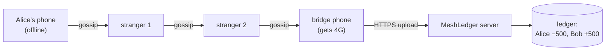

# 1. Overview: what MeshLedger does

> **In one minute**
> - You are in a basement with no signal, and you want to pay a friend.
> - MeshLedger lets your phone seal the payment, pass it phone to phone, and let *any* phone that reaches the internet deliver it to the bank's server.
> - The server opens it, makes sure it is the only copy that counts, and moves the money once.
> - This repo is that server, plus a simulator of the phones, so the whole thing runs on one laptop.
> - v1 works today. v2 adds a shared, crash-safe ledger, a safer offline protocol, and an AI layer that spots fraud. The roadmap has each step.

## The story

Alice is in a basement parking lot with no signal. She owes Bob ₹500.

1. **Alice's phone writes the payment.** It writes "Alice pays Bob ₹500" plus two safety stamps:
   - a random serial number, called the **nonce**;
   - the time she signed it, called **signedAt**.
2. **It seals the payment.** The phone locks it with the bank server's public key. Think of a sealed envelope that only the bank can open. Nobody in between can read it or change it without being caught.
3. **It passes the envelope on.** The phone hands the envelope to nearby phones over Bluetooth, and they hand it to their neighbours. This is called **gossip**. Each hand-off uses up one "hop" from a counter called **TTL**, so an envelope can't bounce around forever.
4. **Someone walks outside.** A stranger's phone that's holding a copy gets 4G. It quietly uploads the envelope to the server. That phone is called a **bridge**.
5. **The server settles the payment.** It opens the envelope, checks it, and moves ₹500 from Alice to Bob in one database transaction.

Several bridges may deliver the *same* envelope, sometimes in the same millisecond. The money must still move exactly once.



## The three promises v1 keeps (Today, v1)

| Promise | How, in one line | Where |
|---|---|---|
| Strangers carry it but can't read or change it | Hybrid encryption: RSA locks a one-time AES key, and AES-GCM seals the payment with a tamper seal | `crypto/HybridCryptoService.java` |
| Three copies arrive, money moves once | The first copy "claims" the packet's fingerprint, and later copies are dropped | `service/IdempotencyService.java` |
| An old envelope replayed later is refused | The payment carries signedAt. Anything older than 24 hours is rejected | `service/BridgeIngestionService.java` |

[Money safety](04-money-safety.md) explains each of these, along with the holes we found in them.

## What's real and what's simulated

| Part | In this repo | In a real deployment |
|---|---|---|
| Encryption and the dedupe logic | Real code, real algorithms | Same idea |
| Sender's phone | The server pretends to be the phone (`/api/demo/send`) | An Android app |
| Bluetooth mesh | A simulator of 5 virtual phones | Real BLE or Wi-Fi Direct |
| Database | H2, in memory, wiped on restart | Postgres (Planned, Day 16) |
| Bank | MeshLedger owns the demo accounts | A real bank core |

## Try it

You need JDK 17. Run:

```bash
./mvnw spring-boot:run          # Windows: mvnw.cmd spring-boot:run
```

Open http://localhost:8080 and use the four buttons in order:

1. **📤 Inject into Mesh**: Alice's phone creates a sealed payment.
2. **🔄 Run Gossip Round**: click it twice. Every phone now holds a copy.
3. **📡 Bridges Upload to Backend**: the bridge phone uploads. The balances change, and a ledger row appears.
4. **🗑 Reset Mesh + Cache**: start over.

To see the "three bridges at once" case, run the test:

```bash
./mvnw test -Dtest=IdempotencyConcurrencyTest
```

It fires 3 threads with the same packet at the same moment. It checks that exactly 1 settles, 2 are dropped, and Alice is charged once.

## What v1 can't do (the honest part)

These are limits of the *idea*, not bugs.

1. **The receiver can't check Alice's balance offline.** Bob gets a promise, not money. If Alice's account is empty when the envelope lands, the payment is rejected, and Bob is out ₹500.
2. **Alice can double-spend offline.** With ₹500 in her account, she can pay Bob in basement A and Carol in basement B. Whichever envelope reaches the server first wins.
3. **Real Bluetooth is hard.** Android limits background Bluetooth heavily. This repo simulates the mesh and skips that problem.
4. **Privacy.** Strangers can't read your envelope, but they know it exists.

On Day 0 we also tested v1 like an attacker would and found real bugs. The worst: a bridge could make *one* payment settle *twice*. These are listed in [Money safety](04-money-safety.md#holes-we-found-in-v1). Each one has a fix day in the [roadmap](07-roadmap.md).

## What v2 adds

| Planned | Day | In one line |
|---|---|---|
| Shared claim store | 15 | Claims live in Redis, or in my own Redis clone, so many servers agree on "first copy" |
| Exactly-once across 3 servers | 16 | Three replicas, one Postgres ledger, double-entry books that must balance |
| Queue between upload and settle | 17 | Kafka, plus a fix so a crash can't block a payment forever |
| Load test | 18 | Hundreds of bridges reconnecting at once |
| Offline allowance + signatures | 19 | The bank reserves part of your balance (a "hold") and signs it, so receivers can check it offline |
| Spend tags | 20 | Payments carry a public running total, so phones can spot a double-spender |
| Fraud simulation and models | 22–24 | Thousands of simulated phones, fraud rings, and two models that score risk |
| AI investigator | 25 | An AI that reads the evidence and writes a case report, citing real transaction IDs |
| Blocklist filter | 26 | A tiny downloadable filter meaning "be careful with this sender" |
| The headline experiment | 27 | Fraud losses with and without the risk layer, against honest payments wrongly declined |

v2 is pitched as **measured risk reduction**. It never claims that double-spending is solved.
