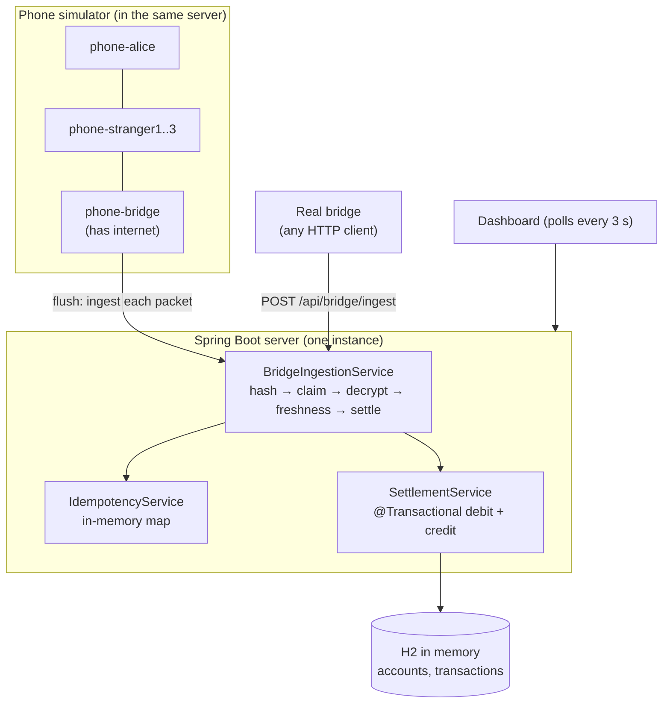
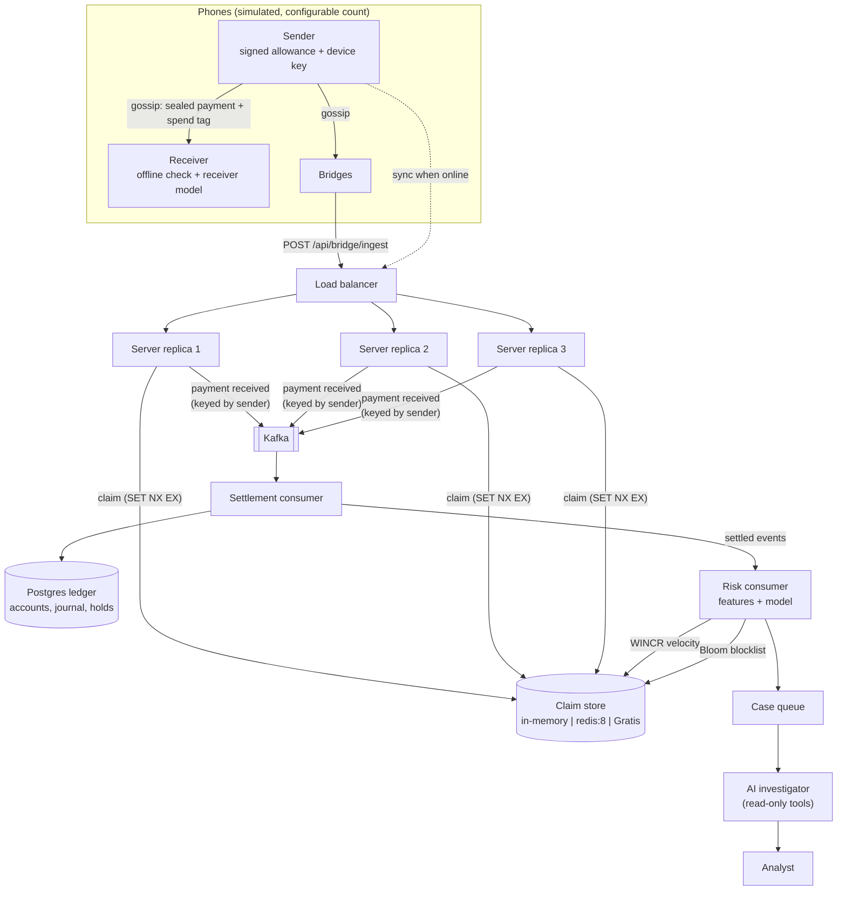
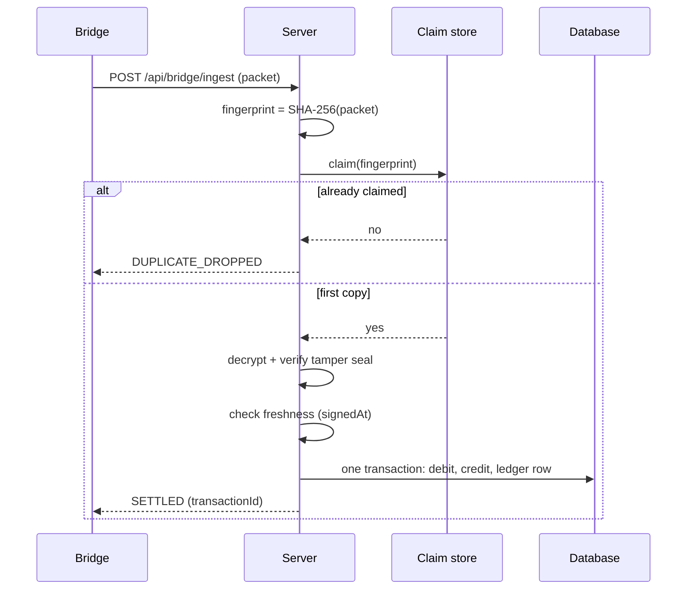

# 2. High-level design (HLD)

> **In one minute**
> - **v1** is one server with an in-memory database and an in-memory "seen it" list, plus a phone simulator.
> - **v2** keeps the same core pipeline: fingerprint → claim → open → check → settle. It spreads that pipeline over several servers, so it needs shared pieces:
>   - a shared claim store (Redis, or my own engine Gratis);
>   - one Postgres ledger with double-entry books;
>   - Kafka between "received" and "settled".
> - v2 also adds two new jobs: a **sync** step that gives each phone a signed offline allowance, and a **risk layer** that watches settled payments and opens fraud cases.

## Who is involved

| Actor | What it does |
|---|---|
| **Sender phone** | Writes, signs and seals the payment. It is offline. |
| **Receiver phone** | Gets the payment offline and decides whether to trust it (Planned, Days 19–23). |
| **Stranger phones** | Carry sealed envelopes they can't read. |
| **Bridge phone** | Any phone that reaches the internet. It uploads every envelope it holds. |
| **MeshLedger server** | Opens, dedupes, checks and settles. It owns the ledger. |
| **Analyst** (Planned) | A human who reads fraud cases and the AI's reports. |

## v1 today

Everything lives in one JVM. That's simple, but it means:
- you can't run two copies, because each would have its own "seen it" list and its own database;
- a restart forgets everything, including the server's RSA key.

## v2 target

What each new box is for:

- **Load balancer + 3 replicas** (Day 16): show that "exactly once" holds when the same packet hits different servers at the same time.
- **Claim store** (Day 15): the "seen it" list moves out of the JVM, so all replicas share it. The claim is a cheap early filter. The real guarantee is a unique key in the database.
  - It can be plain memory (the default), `redis:8`, or **Gratis**, my own Redis-compatible engine. Running it on Gratis is part of the proof.
- **Kafka** (Day 17): splits "we received it" from "we settled it", so upload spikes don't hit the database directly.
  - Messages are keyed by sender, so one sender's payments settle in order.
  - Kafka sits behind a profile. The default path stays synchronous.
- **Postgres ledger** (Day 16): one shared database.
  - Every payment writes two **journal lines**, one debit and one credit, and the books must always balance. This is an idea from Apache Fineract; see [Fineract lessons](06-fineract-lessons.md).
- **Sync and holds** (Day 19): when a phone is online, it syncs. The server **holds** (reserves) part of the balance as an offline allowance and signs a small statement saying so. Receivers can check that signature offline.
- **Risk consumer, case queue, AI investigator** (Days 24–25): watch settled payments, score them, open cases, and explain them. See [The AI layer](05-ai-layer.md).

## The five main flows

### Flow 1: sync (Planned, Day 19)

1. The phone comes online and calls `/api/device/sync`. That endpoint is new; the name is still a draft.
2. The server releases what's left of the old hold, then places a new hold for the offline allowance.
3. The server signs a **snapshot**: device, allowance, sequence number, and valid-until time.
4. The phone stores the snapshot and its own key pair.

### Flow 2: pay offline

- **Today (v1):** the "phone" is the server itself (`DemoService.createPacket`). It writes {sender, receiver, amount, pinHash, nonce, signedAt}, seals it with hybrid encryption, and wraps it in a `MeshPacket` with a TTL.
- **Planned (Days 19–20):** the phone also signs the payment with its device key, attaches its signed snapshot, and adds a clear-text **spend tag** (sender pseudonym + snapshot sequence + running total spent).

### Flow 3: relay

- **Today (v1):** `MeshSimulatorService.gossipOnce()` copies every packet with TTL > 0 to every other phone and takes one off the TTL.
- **Planned (Day 18):** the number of phones and bridges is configurable, and a "reconnect storm" makes hundreds of bridges upload at once.

### Flow 4: settle

That is v1. In v2 (Days 15–17):
- the claim store is shared;
- a duplicate gets the *original* answer back, not just "dropped";
- a claim that crashes halfway expires, so it can't block the payment forever;
- with Kafka on, "SETTLED" becomes "ACCEPTED" and the settlement consumer does the database step.

### Flow 5: detect and investigate (Planned, Days 24–25)

1. The risk consumer reads settled payments and updates features: payments per sender per time window, fan-in and fan-out, bridges with spikes of bad packets.
2. A model scores each payment. A high score opens a case.
3. The AI investigator reads the case through read-only tools and writes a report that cites real transaction IDs. A human decides what to do.

## Quality goals and how each is proven

| Goal | How we prove it | When |
|---|---|---|
| Money moves at most once per payment | 3-thread test today. On Day 16, a duplicate storm across 3 replicas, then the books-balance check | Today, Day 16 |
| No payment is lost because of a crash | A test that crashes after the claim and checks the packet can still settle later | Day 17 |
| Strangers can't read or change payments | The round-trip and tamper tests | Today |
| Replays are refused | Freshness tests, plus the Base64 re-spelling regression test | Today, Day 15 |
| The books always balance | Total debits = total credits, and the sum of all balances never changes | Day 16 |
| Risk is reduced, and we show by how much | Losses vs wrongly declined honest payments, across thresholds | Day 27 |

## Trade-offs we chose

- **Dedupe before decrypting.** RSA is slow, so we check the cheap fingerprint first. The catch: the fingerprint must be of the *bytes*, not of how they are written. Day 0 found this bug ([Money safety](04-money-safety.md)).
- **Claim store = early filter. Database = final word.** Redis can lose a key in a crash. A unique index in Postgres can't be talked out of a duplicate.
- **Kafka is optional.** Async settlement scales better, but the sender loses the instant "SETTLED" reply. So it sits behind a profile, and the default stays synchronous.
- **Holds limit offline spending.** Safer for receivers, less flexible for senders. This is the same trade UPI Lite makes with its pre-funded wallet.
- **Models must beat rules.** Every model is compared against a simple rules baseline on held-out data. If the rules win, we say so.

## Where Gratis plugs in

Gratis is my Redis clone, built in the same 30 days. MeshLedger uses three of its features:

| Gratis feature | Built on | Used by MeshLedger on |
|---|---|---|
| `SET key value NX EX seconds` | Day 8 | Day 15–18: the claim store |
| `WINCR` / `WCOUNT` (windowed counters, event-time aware) | Day 13 | Day 24: per-sender velocity, keyed by signedAt |
| `BF.RESERVE` / `BF.ADD` / `BF.EXISTS` (Bloom filter) | Day 14 | Day 26: the downloadable blocklist |

## Deployment view (Planned, Days 15–16)

The plan is one `docker-compose` file with Redis, Postgres, Kafka, 3 MeshLedger replicas and a small load balancer. Tests that need Docker use Testcontainers and are skipped when Docker isn't there.
