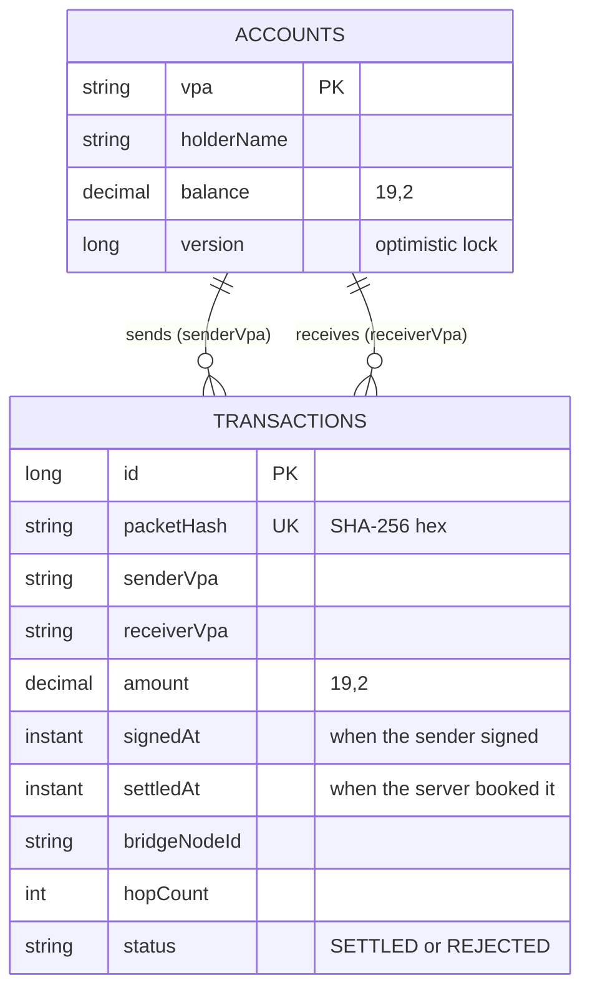

# 3. Low-level design (LLD)

> **In one minute**
> - v1 is 1,168 lines of Java (`wc -l` over `src/main/java`) in four packages:
>   - `model`: data;
>   - `crypto`: sealing and opening;
>   - `service`: the pipeline and the simulator;
>   - `controller`: HTTP.
> - One class, `BridgeIngestionService`, is the heart of it. It runs five steps in a fixed order: fingerprint, claim, decrypt, freshness, settle.
> - Three tools keep money safe under concurrency: an atomic `putIfAbsent`, a database transaction, and a version number on each account.
> - The end of this doc lists the v1 bugs we found and the classes and tables v2 will add.

All paths are under `src/main/java/com/meshledger/` unless they say otherwise.

## Package map

```
com.meshledger
├── MeshLedgerApplication        starts Spring Boot
├── config/AppConfig             turns on @Scheduled jobs
├── model/                       data
│   ├── Account (+Repository)        a bank account: vpa, name, balance, version
│   ├── Transaction (+Repository)    a ledger row: who, whom, how much, status
│   ├── MeshPacket                   the envelope that travels between phones
│   └── PaymentInstruction           what's inside the envelope
├── crypto/
│   ├── ServerKeyHolder              the server's RSA key pair
│   └── HybridCryptoService          seal, open, fingerprint
├── service/
│   ├── BridgeIngestionService       THE pipeline
│   ├── IdempotencyService           the "seen it" list (claims)
│   ├── SettlementService            debit + credit + ledger row, in one transaction
│   ├── DemoService                  seeds accounts; plays the sender's phone
│   ├── MeshSimulatorService         the virtual mesh: inject, gossip, collect uploads
│   └── VirtualDevice                one simulated phone
└── controller/
    ├── ApiController                all REST endpoints
    └── DashboardController          serves the dashboard page
```

## Class by class

| Class | Job | Key methods |
|---|---|---|
| `ServerKeyHolder` | Makes an RSA-2048 key pair at startup and keeps it in memory | `getPublicKey()`, `getPrivateKey()` |
| `HybridCryptoService` | Seals a `PaymentInstruction` with the server's public key, opens it with the private key, and fingerprints a packet | `encrypt`, `decrypt`, `hashCiphertext` |
| `IdempotencyService` | Remembers fingerprints for 24 h. The first caller wins | `claim(hash)`, `evictExpired()` (every 60 s) |
| `SettlementService` | Moves the money, or records a rejection | `settle(...)` (`@Transactional`) |
| `BridgeIngestionService` | Runs the 5-step pipeline and turns every result into an `IngestResult` | `ingest(packet, bridgeId, hops)` |
| `DemoService` | Seeds 4 demo accounts and builds sealed packets like a phone would | `seedAccounts()`, `createPacket(...)` |
| `MeshSimulatorService` | Holds 5 virtual phones and runs gossip rounds | `inject`, `gossipOnce`, `collectBridgeUploads`, `resetMesh` |
| `VirtualDevice` | One phone: an id, "has internet?", and the packets it holds | `hold`, `holds`, `getHeldPackets` |
| `ApiController` | HTTP endpoints for the simulator, the bridge and the dashboard | see [API](#api) |

## The pipeline, step by step

From `service/BridgeIngestionService.java`, shortened. The full method also logs and catches every exception.

```java
String packetHash = crypto.hashCiphertext(packet.getCiphertext());   // 1. fingerprint

if (!idempotency.claim(packetHash)) {                                  // 2. claim
    return IngestResult.duplicate(packetHash);
}

PaymentInstruction instruction;
try {
    instruction = crypto.decrypt(packet.getCiphertext());              // 3. open + tamper check
} catch (Exception e) {
    return IngestResult.invalid(packetHash, "decryption_failed");
}

long ageSeconds = (Instant.now().toEpochMilli() - instruction.getSignedAt()) / 1000;
if (ageSeconds > maxAgeSeconds) return IngestResult.invalid(packetHash, "stale_packet");   // 4. freshness
if (ageSeconds < -300)          return IngestResult.invalid(packetHash, "future_dated");

Transaction tx = settlement.settle(instruction, packetHash, bridgeNodeId, hopCount);      // 5. settle
return IngestResult.settled(packetHash, tx);
```

- **Why this order.** The cheap steps come first. A SHA-256 hash is cheap, while RSA decryption with a private key costs far more. A duplicate storm is stopped at step 2, before any expensive work.
- **What we rejected.** Decrypting first and deduping on the nonce inside. That is correct, but then every duplicate pays for RSA.

## The envelope

### `MeshPacket`: what phones see

| Field | Type | Meaning |
|---|---|---|
| `packetId` | UUID string | Lets phones skip packets they already hold. Not trusted by the server. |
| `ttl` | int ≥ 0 | Hops left. Each phone that forwards it takes one off. |
| `createdAt` | epoch ms | When the sender made it. Not trusted by the server. |
| `ciphertext` | Base64 string | The sealed payment. Phones can't read it. |

Anyone carrying the packet can change the outer fields, so the server never trusts them. It trusts only what is inside the seal.

### `PaymentInstruction`: what's inside the seal

| Field | Meaning |
|---|---|
| `senderVpa`, `receiverVpa` | Who pays whom (a VPA looks like `alice@demo`) |
| `amount` | `BigDecimal` |
| `pinHash` | SHA-256 of the PIN. Recorded only, never checked (see [bugs](#known-v1-bugs)) |
| `nonce` | A random UUID for this payment |
| `signedAt` | Epoch ms when the sender made it |

### Byte layout of `ciphertext` (before Base64)

```
┌──────────────────────────────┬────────────┬──────────────────────────────────┐
│ RSA-OAEP(SHA-256) wrapped     │ AES-GCM IV │ AES-256-GCM ciphertext + 16-byte │
│ AES-256 key: 256 bytes        │ 12 bytes   │ tag (the tamper seal)            │
└──────────────────────────────┴────────────┴──────────────────────────────────┘
```

Every packet gets a fresh AES key and IV, so two payments with the same text still seal differently.

## Data model



- The tables are created by Hibernate (`ddl-auto=create-drop`) in H2, in memory.
- `senderVpa` and `receiverVpa` are plain strings, not real foreign keys. The diagram shows the meaning.
- A `REJECTED` row is written for an overspend, so the ledger shows the attempt.

## API

| Method | Path | What it does |
|---|---|---|
| GET | `/` | The dashboard |
| GET | `/api/server-key` | The server's RSA public key (Base64) |
| GET | `/api/accounts` | All accounts and balances |
| GET | `/api/transactions` | The last 20 ledger rows |
| GET | `/api/mesh/state` | Each virtual phone and its packets, plus the claim-list size |
| POST | `/api/demo/send` | Pretend to be the sender: seal a payment and inject it at a phone (default `phone-alice`, TTL 5) |
| POST | `/api/mesh/gossip` | One gossip round |
| POST | `/api/mesh/flush` | Bridges with internet upload everything they hold, in parallel |
| POST | `/api/mesh/reset` | Empty the mesh and the claim list |
| POST | `/api/bridge/ingest` | **The real endpoint** a bridge phone calls |
| GET | `/h2-console` | Browse the in-memory database |

`POST /api/bridge/ingest` takes a `MeshPacket` as JSON, plus two optional headers:
- `X-Bridge-Node-Id` (default `unknown`);
- `X-Hop-Count` (default `0`).

It always replies HTTP 200 with an `IngestResult`:

```json
{ "outcome": "SETTLED", "packetHash": "a3f8…", "reason": null, "transactionId": 42 }
```

## Outcomes

| `outcome` | `reason` | When | Ledger effect |
|---|---|---|---|
| `SETTLED` | null | First copy, opens fine, fresh, accounts exist | Debit + credit + `SETTLED` row. **Also returned for an overspend**, which writes a `REJECTED` row (a bug) |
| `DUPLICATE_DROPPED` | null | The fingerprint was already claimed | None |
| `INVALID` | `decryption_failed` | Wrong key, or the tamper seal is broken | None |
| `INVALID` | `stale_packet` | `signedAt` is more than `packet-max-age-seconds` ago | None |
| `INVALID` | `future_dated` | `signedAt` is more than 300 s in the future | None |
| `INVALID` | `internal_error: …` | Any other exception, e.g. unknown account | None, **but the claim stays**, so the packet is blocked for 24 h (a bug) |

## Settings

From `src/main/resources/application.properties`:

| Key | Default | Meaning |
|---|---|---|
| `server.port` | `${PORT:8080}` | HTTP port. Cloud hosts set `PORT` |
| `spring.datasource.url` | `jdbc:h2:mem:meshledger` | In-memory database |
| `spring.jpa.hibernate.ddl-auto` | `create-drop` | Tables are made at start and dropped at stop |
| `spring.h2.console.enabled` | `true` | DB console at `/h2-console` |
| `upi.mesh.idempotency-ttl-seconds` | `86400` | How long a claim is remembered |
| `upi.mesh.packet-max-age-seconds` | `86400` | The freshness window |

## How concurrency is handled

Three tools, from cheapest to strongest:

1. **`ConcurrentHashMap.putIfAbsent`** in `IdempotencyService.claim`. It is atomic: if 100 threads try the same key at once, exactly one gets `null` back and wins. This is the JVM version of Redis `SET NX`.
2. **`@Transactional`** on `SettlementService.settle`. The debit, the credit and the ledger row commit together or not at all.
3. **`@Version`** on `Account`. Each save checks that the version hasn't changed since the read. If two transactions update the same account, the second fails instead of silently overwriting the first. This is **optimistic locking**.

There is also a **unique index on `transactions.packetHash`**, so the database refuses a second row for the same fingerprint.

## The simulator

- **5 phones**, made in the constructor: `phone-alice`, `phone-stranger1`, `phone-stranger2`, `phone-stranger3` (all offline), and `phone-bridge` (online).
- **A gossip round** first snapshots what every phone holds. Then every packet with TTL > 0 is copied to every phone that doesn't have it yet, with TTL − 1. The snapshot stops a packet from travelling several hops in one round.
- **Flush** collects every packet held by an online phone and calls `ingest` for each one in a `parallelStream`. That is an in-process call, not HTTP. The hop count is `5 − ttl`.

## Known v1 bugs

Found on Day 0 by sending real packets to the running v1 server. The same probe was re-run on MeshLedger before tagging `v1-baseline`, with the same results.

| # | Bug | What we saw | Fix day |
|---|---|---|---|
| 1 | The fingerprint is a hash of the Base64 **text**, not the bytes | The same payment, re-spelled, **settled twice**: Alice 5000 → 4800 for one ₹100 payment | 15 |
| 2 | An overspend is reported as `SETTLED` | The API said `SETTLED` while the ledger row said `REJECTED` | 15 |
| 3 | A failure after the claim never releases it | An unknown receiver gave `INVALID`, then the same packet gave `DUPLICATE_DROPPED` | 15 (typed outcome), 17 (lease) |
| 4 | Two payments from one sender can collide on `@Version` | Not reproduced yet, only read in the code. The loser would get `INVALID` and a stuck claim | 17 |
| 5 | A new RSA key on every start | Packets sealed before a restart can't be opened, and replicas can't share | 16 |
| 6 | The PIN is an unsalted SHA-256 of 4 digits | Anyone can try all 10,000 PINs. It is recorded but never checked | Out of scope (a real bank checks the PIN) |
| 7 | No authentication on `/api/bridge/ingest` | Anyone can post packets | Partly covered by the Day 24 per-bridge features |

[Money safety](04-money-safety.md) explains bugs 1–4 in plain words.

## Planned v2 additions (drafts)

These are designs, not code. Names and columns can change on the day they're built.

### Day 15: the claim store

```java
public interface IdempotencyStore {
    ClaimResult claim(String key, Duration ttl);        // FIRST, or the stored record of an earlier claim
    void complete(String key, Outcome outcome, Long transactionId);
    void release(String key);                           // after a failure that must not block the packet
}
```

- **The key** becomes SHA-256 of the **decoded bytes**, and non-canonical Base64 is rejected. The ledger also gets a unique `(sender_vpa, nonce)`.
- **The record** is `{state: IN_PROGRESS | DONE, outcome, transactionId, leaseUntil}`. A duplicate of a `DONE` payment gets the original answer back. This idea comes from Fineract's `Idempotency-Key` ([lesson 1](06-fineract-lessons.md#1-idempotency-that-remembers-the-answer)).
- **Implementations:**
  - `InMemoryIdempotencyStore` is the default.
  - `RedisIdempotencyStore` sends `SET <key> <record> NX EX 86400`. Day 15 documents the exact command.
  - Which one runs is chosen by a property; the name is decided on Day 15.
- **Outcomes** become a typed enum: `SETTLED`, `REJECTED`, `DUPLICATE`, `IN_PROGRESS`, `INVALID`. `INVALID` gets reason codes such as `UNKNOWN_ACCOUNT`, never `internal_error`.

### Day 16: the ledger

| Table | Columns (draft) | Rule |
|---|---|---|
| `journal_entries` | id, transaction_id, account_vpa, side (DEBIT/CREDIT), amount, value_date, booking_date, reversal_of | 2 lines per payment, and debits = credits. Append-only |
| `transactions` | as today, plus a unique `(sender_vpa, nonce)` | Never updated or deleted. A correction is a new reversing entry |

The schema is managed by **Liquibase** (`db/changelog/master.xml` + numbered parts). A test fails if any part isn't registered.

### Day 19: devices, holds, snapshots

| Table | Columns (draft) |
|---|---|
| `devices` | device_id, owner_vpa, public_key, registered_at |
| `holds` | id, account_vpa, device_id, amount, used, status (ACTIVE/RELEASED/EXPIRED), placed_at, valid_until |
| `snapshots` | device_id, seq, allowance, valid_until, server_signature |

- Withdrawable balance = balance − active holds.
- Time comes from one injected `Clock`, so tests and the simulator can move it forward.
- A nightly close-of-business job releases expired holds and runs the books-balance check.

### Day 20: the spend tag

A small clear-text label on every payment: `{senderPseudonym, snapshotSeq, cumulativeSpent}`.

Phones can read it, but they can't open the seal. If two tags carry the same pseudonym and sequence but disagree on the totals, that is evidence of a double-spend.
