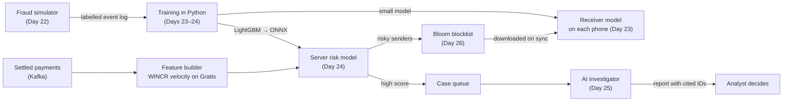

# 5. The AI layer: how it works

> **In one minute**
> - Nothing in this doc is built yet. It is Days 22–27 of the plan.
> - There are four parts:
>   1. a **simulator** that makes realistic fraud with known answers;
>   2. a small **receiver model** that runs on the phone, offline;
>   3. a **server model** that scores settled payments and opens cases;
>   4. an **AI investigator** that reads a case and writes a report citing real evidence.
>   A **Bloom-filter blocklist** ties them back to the phones.
> - Every model has to beat simple rules on data it has never seen, or we say the rules won.
> - The AI never moves money and never approves anything. A human decides.

## Why AI here at all?

Rules catch the obvious: "more than ₹X offline", "too many payments in an hour".

Some fraud only shows as a **pattern across many payments**:
- a ring of accounts passing money in circles;
- one sender who appears in two basements at once;
- a bridge that holds packets back and dumps them later.

Patterns like these are hard to write as rules and easier for a model to learn from examples. But a model is only worth keeping if it **measurably** beats the rules, so the rules stay as the baseline in every comparison.

## What a model is, in plain words

- A **model** is a function that learns from examples. You show it many payments, each labelled "fraud" or "honest", and it learns which combinations of facts tend to mean fraud.
- The facts it looks at are called **features**, for example "how many payments did this sender make in the last 10 minutes?"
- The answer it gives is a **score** from 0 to 1. A **threshold** turns the score into a decision: above 0.8, refuse; above 0.5, confirm first; otherwise accept. Those thresholds are only an example.
- **Training** is the learning step, done offline in Python. **Inference** is using the trained model on new payments, done in Java inside MeshLedger.

## The pipeline

## Step 1: make fraud we can learn from (Day 22)

Real fraud data for offline UPI doesn't exist publicly, so we simulate it.

- **Thousands of phones** with locations that move over time. Movement matters: a cross-basement double-spend is only possible if the sender moves between groups that don't touch.
- **Four kinds of users:**

| Kind | Behaviour |
|---|---|
| Honest | Normal payments within their means |
| Overspender | Sometimes pays more than they have |
| Double-spender | Spends the same allowance in two places |
| Mule ring | A group passing money around to hide where it came from |

- **Fixed seeds.** A **seed** is the starting number for the random generator. Fix it, and the "random" world is the same on every run, so results can be repeated exactly.
- **A labelled event log.** Every event records who did it and whether it was fraud. These are the "answers" the models learn from.
- **The train/test split is by ring, not by payment.** If one ring's payments appear in both training and testing, the model can memorise that ring's members and look clever without learning anything general. It's like seeing the exam questions in advance. So whole rings go to one side or the other.

## Step 2: the receiver model, offline on the phone (Day 23)

Bob's phone has no internet, but it has to decide about Alice's payment *now*.

- **What it can see offline:**
  - Alice's signed allowance and how old that snapshot is;
  - the amount;
  - spend tags it has already seen from Alice;
  - whether Alice is in the downloaded blocklist (Day 26);
  - its own past contact with Alice.
- **The output:** one of **accept**, **confirm first**, **refuse**. "Confirm first" means: don't hand over the goods yet, get one more check, or accept a smaller amount.
- **How it runs:** it is trained in Python and run inside each `VirtualDevice` in Java. It has to be small and fast, because a phone is not a server. The exact model and export format are chosen on Day 23.
- **How it is judged:** **PR-AUC** on rings it has never seen, compared with the Day 20 rules.

## Step 3: the server risk model (Day 24)

After a payment settles, the server can see far more than a phone.

**Features (the facts per payment):**

| Feature | Plain meaning | Why it matters |
|---|---|---|
| Sender velocity | Payments per sender per time window, counted with Gratis's `WINCR`, **keyed by signedAt** | Bursts of spending. It is keyed by when the payment *happened*, not when it arrived: offline payments arrive late, and counting by arrival time would blur a burst into a trickle |
| Fan-out / fan-in | How many different people a sender pays, or a receiver gets money from | Mules collect from many and pay out to a few |
| Bridge INVALID spikes | A bridge suddenly sending many broken packets | A tampering or junk-spraying bridge |
| Packet withholding | A bridge that holds packets far longer than others, then dumps them | Someone timing a double-spend |
| Repeat overspender | Past `REJECTED` payments from this sender | History predicts behaviour |

**The model: LightGBM.** A **gradient-boosted tree** model: many small yes/no decision trees, where each new tree fixes the mistakes of the ones before. It is strong on table-shaped data like the features above and cheap to run.

**Train in Python, run in Java.** The model is exported to **ONNX**, a standard file format for trained models, and run with **ONNX Runtime** for Java. That means no Python process in the payment path.

**Output:** a score per payment. Above the threshold, a case opens in the **case queue**.

## Step 4: the AI investigator (Day 25)

A case says "this looks risky". It doesn't say *why*, or who else is involved.

- **What it is:** a large language model (**LLM**) agent that can call **tools**. The tools are exposed over **MCP** (Model Context Protocol), a standard way to give an AI tools.
- **The tools are read-only:**
  - look up a payment;
  - list a sender's payments;
  - show the features behind a score;
  - list who paid whom around a case.
- They use a database user that **cannot write**.
- **What it produces:** a case report in plain English. Every claim cites real transaction IDs, for example "these 6 accounts form a loop: tx 1042 → 1043 → …".
- **How it is judged:**
  1. Did it name the right ring members? We know them from the simulator's labels.
  2. Did it invent anything? Every cited ID is checked against the ledger, and the target is **zero invented IDs**.
- **Which LLM:** decided on Day 25. A local model through Ollama is one option.
- **What it cannot do:** reverse a payment, block a user, or close a case. It only writes. A human reads and decides.

## Step 5: the blocklist (Day 26)

A **Bloom filter** is a tiny bit array that answers "have I seen this before?" with either **"definitely not"** or **"maybe"**.

- It never misses a sender that was added.
- Sometimes it says "maybe" for one that wasn't. That's a **false positive**.

Gratis builds the filter from risky senders (`BF.RESERVE`, `BF.ADD`), and phones download it on sync. Because of false positives, **a hit means "confirm first", never "block"**. Day 26 measures the false-positive rate for different filter sizes.

## Step 6: the headline experiment (Day 27)

The single number that matters is a **trade-off curve**.

- **x-axis:** % of honest payments wrongly declined or delayed (the cost to honest users);
- **y-axis:** double-spend losses that still get through (the cost to the system).

It is drawn for: no risk layer, rules only, and rules + models, across many thresholds. A good layer pushes the curve down: fewer losses at the same annoyance. If the rules alone do as well, the result says that.

## Metrics in plain words

| Term | Plain meaning |
|---|---|
| **Precision** | Of the payments we flagged, how many really were fraud? Low precision means many honest people get bothered. |
| **Recall** | Of all the fraud, how much did we flag? Low recall means fraud slips through. |
| **Threshold** | The score cut-off. Raising it gives higher precision and lower recall, and lowering it does the opposite. |
| **PR-AUC** | Precision and recall across *every* threshold, rolled into one number from 0 to 1. Higher is better. |
| **False decline** | An honest payment refused or delayed. |

**Why not just "accuracy"?** Fraud is rare. If 1 payment in 100 is fraud, a model that always says "honest" is 99% accurate and completely useless. PR-AUC doesn't fall for that.

## What the AI never does

- Never moves, reverses or blocks money on its own.
- Never approves its own suggestion.
- Never invents evidence: every cited ID is checked automatically.
- Never gets described as having "solved double-spending". The claim is always a measured reduction, with the cost to honest users shown next to it.
